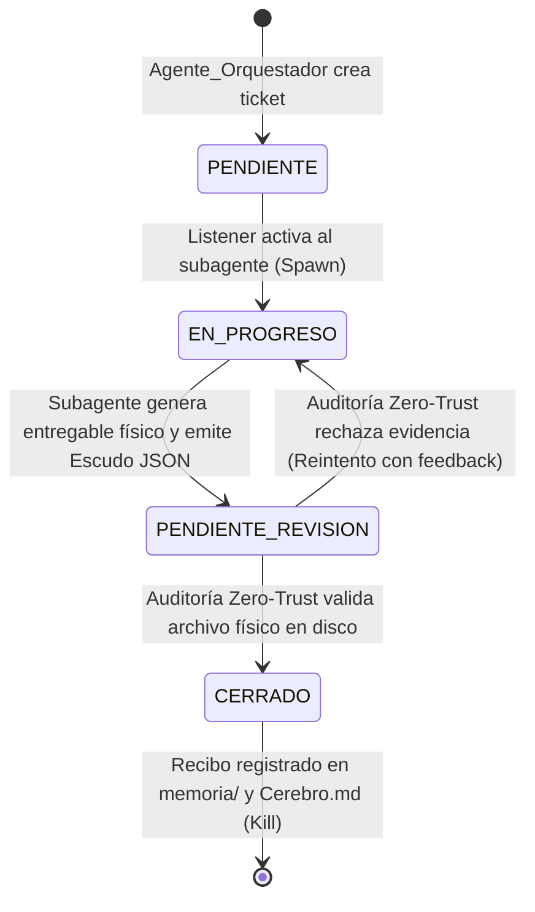

# Protocolo de Coordinación y Comunicación Inter-Agente

Este documento establece las directivas formales que rigen la interacción, delegación de tareas, ciclo de vida efímero y cierre de misiones entre el **Agente Orquestador** y los subagentes especializados (`Subagente_Desarrollo`, `Subagente_Diseno`, `Subagente_Ciberseguridad`, `Subagente_Asistencia`).

---

## 1. La Pizarra Central: `Bitacora.md` (SSOT Operativo)

`Bitacora.md` es el tablero de tareas central (*Blackboard*) y el **único canal oficial de coordinación y delegación de la tripulación**.
- **Prohibición de Canales Paralelos:** Queda terminantemente prohibida la delegación mediante mensajes flotantes no rastreables o sockets ad-hoc.
- **Transparencia Absoluta:** Toda tarea, bloqueo, duda o reporte técnico se documenta físicamente dentro del ticket correspondiente en la Bitácora.

---

## 2. Formato Canónico de Tickets de Delegación

Toda tarea formal en la Pizarra debe ajustarse estrictamente a la plantilla estructurada:

```markdown
## TKT-[ROL]-[YYYYMMDD][SEC]: [Título conciso de la tarea técnica]
- **Tarea:** Descripción precisa, unívoca y atómica del requerimiento.
- **Responsable:** [Subagente_Desarrollo | Subagente_Diseno | Subagente_Ciberseguridad | Subagente_Asistencia]
- **Estado:** PENDIENTE
- **Fecha:** YYYY-MM-DD HH:MM
- **Directrices:** Restricciones técnicas, dependencias, frameworks permitidos y directivas de calidad.
- **Evidencia_Esperada:** Ruta física obligatoria esperada en disco (/app/<Agente>/<carpeta>/...).
- **Historial:**
  - YYYY-MM-DD HH:MM - Agente_Orquestador: Creación del ticket y asignación formal.
```

---

## 3. Máquina de Estados del Ticket

El ciclo de vida operativo de un ticket sigue una transición determinista:



1. **`PENDIENTE`:** Ticket creado por el Orquestador listo para ser tomado.
2. **`EN_PROGRESO`:** Subproceso efímero del subagente activo trabajando en la tarea.
3. **`PENDIENTE_REVISION`:** El subagente generó el entregable físico en disco y solicita inspección.
4. **`CERRADO`:** El Orquestador auditó físicamente el archivo en disco, confirmó su validez y cerró el ciclo.

---

## 4. Ciclo de Vida Efímero bajo Demanda (Spawn $\rightarrow$ Exec $\rightarrow$ Kill)

Para garantizar consumo cero de recursos en reposo y aislamiento absoluto de contexto:
1. **Spawn:** `base_listener.py` detecta un ticket dirigido al agente e invoca un subproceso Python aislado (`subprocess.Popen`).
2. **Exec:** El subagente carga su perfil canónico desde `_agents/agente.md`, resuelve sus herramientas especializadas bajo el interceptor de autocorrección y deposita los entregables físicos en su carpeta oficial.
3. **Kill:** El subagente emite su Escudo JSON de cierre, el subproceso finaliza y libera la memoria RAM/GPU del servidor.

---

## 5. Salida Formal Obligatoria: El Escudo JSON de Cierre

Para concluir su turno, todo subagente debe emitir como última respuesta un objeto JSON válido y parseable:

```json
{
  "ticket_actualizado": "## TKT-[ROL]-[ID]: [Título]\n- **Estado:** PENDIENTE_REVISION\n- **Responsable:** Agente_Orquestador\n- **Historial:**\n  - YYYY-MM-DD HH:MM - [Agente]: Resumen de entregables generados.\n- **Evidencia_Fisica:** `/app/[Agente]/[carpeta]/[archivo_generado]`",
  "evidencia_hallazgo": "/app/[Agente]/[carpeta]/[archivo_generado]"
}
```

### Reglas de Validación:
- **`ticket_actualizado`:** Bloque Markdown íntegro del ticket con el historial extendido y estado actualizado.
- **`evidencia_hallazgo`:** Ruta absoluta en disco que debe existir físicamente en el momento del cierre.

---

## 6. Auditoría Física Zero-Trust del Orquestador

El Agente Orquestador opera bajo la **Doctrina Zero-Trust**:
1. **Inspección Física en Disco:** Utiliza herramientas de lectura (`leer_archivo`) e inspección de directorios (`listar_directorio`) para constatar que el archivo en `evidencia_hallazgo` existe físicamente.
2. **Comprobación Temporal (mtime):** Verifica que la marca temporal de modificación del archivo sea posterior a la asignación del ticket.
3. **Evaluación de Contenido:** Verifica que el archivo no contenga stubs vacíos, mensajes de error o código incompleto.
4. **Rechazo Implacable:** Si la evidencia física no existe o no satisface el requerimiento, el Orquestador revierte el ticket a `EN_PROGRESO` con un regaño correctivo en el historial.

---

## 7. Middleware de Resiliencia: QA Gherkin y Filtro Anti-Bucle

Durante la fase de ejecución, todas las invocaciones a herramientas pasan por `Agente_Orquestador/bucle_autocorreccion.py`:
- **Filtro Anti-Bucle (Pilar 3):** Congela llamadas redundantes con argumentos idénticos y fuerza al agente a analizar los datos ya obtenidos en su contexto.
- **Doble Validación QA Gherkin:** Evalúa en tiempo real la conectividad/exit code (Capa 1) y el contenido analizable frente al objetivo del ticket (Capa 2).
- **Auto-Diagnóstico de Causa Raíz:** Inyecta recetas específicas de remediación ante fallos sintácticos, de red o de dependencias, escalando automáticamente al Orquestador al tercer intento consecutivo.

---

## 8. Consolidación de Conocimiento a Largo Plazo

Una vez que un ticket alcanza el estado `CERRADO`:
- **Recibo Ejecutivo de Misión:** Se redacta y archiva el recibo técnico en `memoria/` detallando agentes participantes, herramientas usadas, decisiones tomadas y ruta de evidencia física.
- **Indexación en Cerebro:** Se anexa la entrada correspondiente con hiperenlace en `Cerebro.md`.

---
**Conexiones:** [[sistema]]
