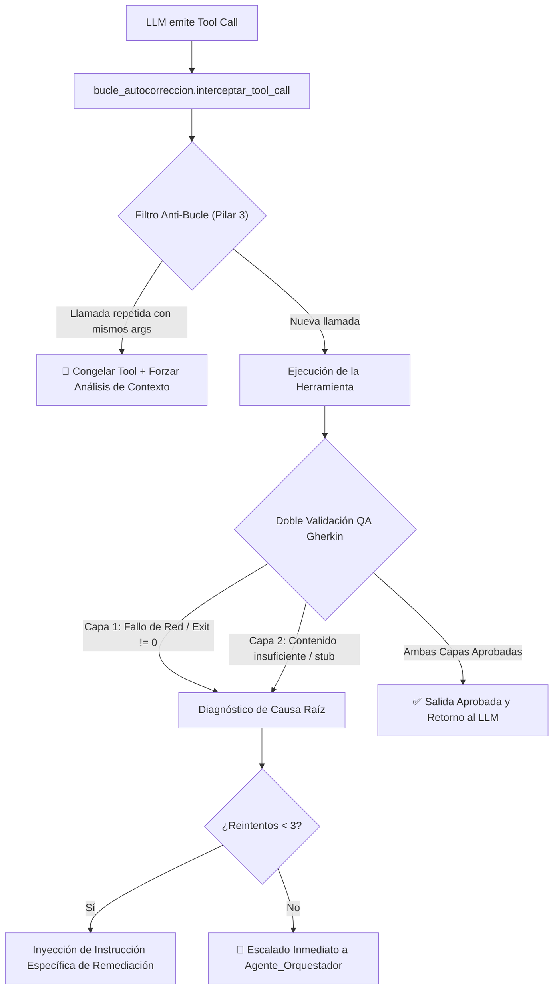

# Arquitectura del Sistema (Antigravity 2.0)

El ecosistema multi-agente está diseñado como un **Gemelo Digital Vivo (RAG + Grafo de Obsidian)**, operando bajo la estricta **Arquitectura de Nodos, Órbitas y Auditoría Zero-Trust**. Queda prohibida la comunicación asíncrona no rastreable y la aprobación ciega de tareas sin evidencia física verificable en el disco.

---

## 1. El Agente Orquestador (Dirección Estratégica)

El **Agente Orquestador** actúa como el núcleo directivo y supervisor supremo de la tripulación. Es el único punto de contacto primario con el usuario humano y el árbitro de la Pizarra de tareas (`Bitacora.md`).

- **Identidad Canónica:** `Agente_Orquestador`
- **Fuente Única de Verdad (SSOT):** `Agente_Orquestador/_agents/agente.md`
- **Identidad Dinámica:** Su alias conversacional (por defecto *Luffy*) se gestiona dinámicamente mediante `identidad_agentes.py`, permitiendo personalización sin afectar el código de orquestación.
- **Herramientas Propias:** Cuenta con 14 habilidades modulares (22 herramientas registradas) para investigación web, refinamiento de objetivos, entrevistas guiadas, planificación atómica (`PLAN-*.md`), higiene de workspace y observabilidad Sentry.
- **Responsabilidad Global:** Mantiene enlazados los nodos de gobernanza global (`Bitacora.md`, `Cerebro.md`, `protocolo/` y `sistema/`).

---

## 2. Subagentes Especializados (Subnodos Ejecutores)

Los 4 subagentes de la tripulación operan como especialistas técnicos que se activan bajo demanda efímera (**Spawn -> Exec -> Kill**) ante tickets asignados en la Bitácora:

1. **Subagente de Desarrollo (`Subagente_Desarrollo`):**
   - **Misión:** Ingeniería de software full-stack, entornos virtuales Python, scaffolding web/móvil, repositorios Git, arquitectura UI/UX y flujos de automatización n8n.
   - **Carpeta de Entregables:** `Subagente_Desarrollo/proyectos/`
   - **SSOT de Identidad:** `Subagente_Desarrollo/_agents/agente.md`
   - **Documentación:** Documentacion_Subagente_Desarrollo y Script_Subagente_Desarrollo_Agent.

2. **Subagente de Diseño (`Subagente_Diseno`):**
   - **Misión:** Dirección de arte publicitario (Higgsfield AI), renderizado local Pillow (Dark Bento / Instagram 1080x1350), producción de vídeo I2V en 2 pasos, postproducción con FFmpeg, descarga multimedia (`yt-dlp`) y diapositivas ejecutivas con Marp.
   - **Carpeta de Entregables:** `Subagente_Diseno/informes/`
   - **SSOT de Identidad:** `Subagente_Diseno/_agents/agente.md`
   - **Documentación:** Documentacion_Subagente_Diseno y Script_Subagente_Diseno_Agent.

3. **Subagente de Ciberseguridad (`Subagente_Ciberseguridad`):**
   - **Misión:** Auditoría estática SAST y detección de credenciales, análisis dinámico SCA de dependencias (CVEs con `pip-audit`), inspección de puertos y red, blindaje de webhooks n8n, reportes inmutables y centinela SOC del Dashboard.
   - **Carpeta de Entregables:** `Subagente_Ciberseguridad/reportes/`
   - **SSOT de Identidad:** `Subagente_Ciberseguridad/_agents/agente.md`
   - **Documentación:** Documentacion_Subagente_Ciberseguridad y Script_Subagente_Ciberseguridad_Agent.

4. **Subagente de Asistencia (`Subagente_Asistencia`):**
   - **Misión:** Gestión ofimática ejecutiva, clasificación inteligente de correo (Gmail), agenda (Google Calendar), almacenamiento cloud (Google Drive & Docs), extracción documental PDF (`pypdf`), clima (Open-Meteo) y observabilidad (Sentry).
   - **Carpeta de Entregables:** `Subagente_Asistencia/documentos_asistencia/`
   - **SSOT de Identidad:** `Subagente_Asistencia/_agents/agente.md`
   - **Documentación:** Documentacion_Subagente_Asistencia y Script_Subagente_Asistencia_Agent.

---

## 3. Capa de Verificación y Resiliencia: QA Gherkin y Bucle de Autocorrección

Para garantizar determinismo operativo y erradicar alucinaciones o bloqueos en la ejecución de herramientas, el sistema incorpora dos motores transversales ubicados en `Agente_Orquestador/` y conectados a toda la flota:



1. **`Agente_Orquestador/qa_gherkin.py` (QA Gherkin Universal):**
   - Evalúa cada tool call bajo el principio de **Doble Validación**:
     - *Capa 1 (Infraestructura):* Verifica códigos HTTP exitosos (200/201/204), códigos de retorno (`exit_code == 0`) y ausencia de fallos de red o caídas.
     - *Capa 2 (Contenido):* Impide el cierre si la respuesta es un stub vacío o carece de datos sustanciales requeridos por el objetivo del ticket.
   - Documentación completa en Script_Qa_Gherkin.

2. **`Agente_Orquestador/bucle_autocorreccion.py` (Resiliencia y Anti-Bucle):**
   - **Filtro Anti-Bucle (Pilar 3):** Congela herramientas que se intenten ejecutar repetitivamente con los mismos argumentos tras haber obtenido respuesta.
   - **Clasificador de Causa Raíz (`_clasificar_error`):** Reconoce 10 patrones de fallo (módulos ausentes, puertos en uso, permisos, rutas inexistentes, errores de sintaxis, timeouts, JSON inválido) e inyecta la instrucción correctiva obligatoria.
   - **Escalado Automático:** Si una herramienta falla 3 veces consecutivas, el ticket se escala automáticamente al `Agente_Orquestador`.
   - Documentación completa en Script_Bucle_Autocorreccion.

---

## 4. Memoria y Persistencia: La Memoria Bifocal

El ecosistema sincroniza el conocimiento simultáneamente en dos frentes mediante `Agente_Orquestador/sync_cerebro.py`:

1. **Grafo Orgánico de Obsidian (Vista Humana):**
   - Los nodos se definen mediante archivos Markdown enlazados bidireccionalmente (`...`).
   - El archivo canónico de identidad de cada agente reside en su carpeta `_agents/agente.md`.
2. **Bóveda Vectorial ChromaDB (Subconsciente LLM):**
   - Los documentos Markdown de habilidades y protocolos se indexan vectorialmente (`all-MiniLM-L6-v2`), permitiendo a los agentes consultar procedimientos previos (*Playbooks*) mediante búsqueda semántica.
3. **Consolidación del Directorio `memoria/`:**
   - Erradicación permanente de rutas legadas (`memoria_compartida`).
   - Estructura limpia y preservada con sus 4 archivos esenciales:
     - `Tickets_Archivados.md`: Registro histórico de tareas completadas.
     - `Perfil de wuil.md`: Preferencias, perfil y directivas del usuario humano.
     - `memoria.md`: Nodo conector del cerebro de memoria.
     - `Memoria_Viva_Errores.md`: Bóveda procedural de fallos detectados y vacunas técnicas aplicadas.

---

## 5. Protocolo de Coordinación: La Pizarra (`Bitacora.md`)

`Bitacora.md` es el tablero central de tareas (*Blackboard*) y el único punto oficial de delegación inter-agente.
- **Creación de Tickets:** El Agente Orquestador descompone las misiones en tickets atómicos con formato `## TKT-[ROL]-[ID]`.
- **Estados Operativos:** `PENDIENTE` -> `EN_PROGRESO` -> `PENDIENTE_REVISION` -> `CERRADO`.
- **Auditoría Zero-Trust:** El Orquestador nunca da por completado un ticket sin inspeccionar físicamente en disco la ruta indicada en `Evidencia_Esperada` y verificar que su contenido sea real y válido.

---

## 6. Topología Física del Workspace

Los componentes del sistema se estructuran de manera estricta y compartimentada:

```
c:\Users\admin\Documents\Agentes\
├── Agente_Orquestador/        # Dirección, listener, QA Gherkin, bucle autocorrección, sync
├── Subagente_Desarrollo/       # Proyectos de software, git, web, móvil, n8n
├── Subagente_Diseno/           # Informes creativos, feeds, vídeo, Marp
├── Subagente_Ciberseguridad/   # Reportes de auditoría SAST/SCA, inspección y SOC
├── Subagente_Asistencia/       # Documentos ofimáticos, Gmail, Calendar, Drive, PDF
├── Bitacora.md                 # Blackboard central de tickets y coordinación
├── Cerebro.md                  # Índice histórico de soluciones consolidadas
├── memoria/                    # Memoria viva y persistencia a largo plazo
├── protocolo/                  # Reglas de la tripulación y protocolos inter-agente
├── sistema/                    # Biblioteca técnica de arquitectura y scripts
└── Archivos_temporales/        # Zona de staging efímera para purga automática
```

---
**Conexiones:** [[sistema]]
