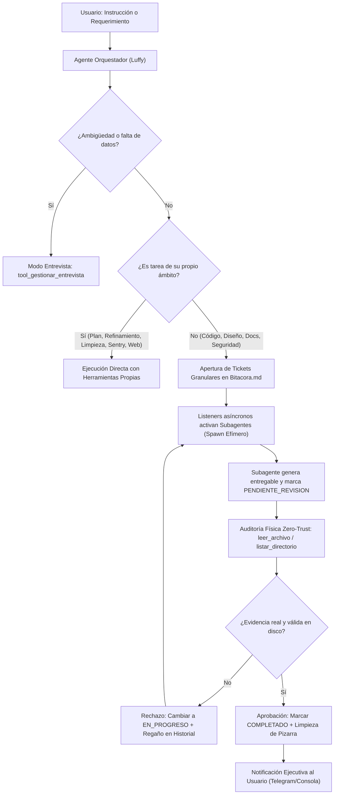

# Documentación del Sistema: Agente Orquestador (Luffy)

**Identificador Canónico de Sistema:** `Agente_Orquestador`  
**Identidad Conversacional / Alias de Tripulación:** `Luffy` *(configurable dinámicamente: Luffy, Eda, Aurora, etc.)*  
**Perfil Maestro (SSOT):** `Agente_Orquestador/_agents/agente.md`  
**Script Ejecutable Principal:** `Agente_Orquestador/agente_orquestador_agent.py`  
**Daemon de Activación / Listener:** `Agente_Orquestador/base_listener.py`  
**Motor de Verificación y Resiliencia:** `Agente_Orquestador/qa_gherkin.py` y `Agente_Orquestador/bucle_autocorreccion.py`  
**Única Fuente de Verdad Operativa (SSOT):** `Bitacora.md`  
**Estado Operativo:** Modernizado, Modularizado en 14 Skills Canónicas (22 herramientas registradas), SSOT Consolidado con Protocolos de Delegación y Auditoría Física Zero-Trust, Inyección Dinámica por Modos, Motor QA Gherkin y Filtro Anti-Bucle Integrado.

---

## 1. Misión y Rol en la Flota

El **Agente Orquestador** es el Director de Operaciones, Supervisor Supremo y Arquitecto Estratégico del ecosistema autónomo de agentes. Opera como la interfaz directiva con el usuario humano y el árbitro de la Pizarra (`Bitacora.md`).

Sus responsabilidades primarias comprenden:
- **Atención Directa al Usuario:** Recepción de requerimientos, diálogo ejecutivo, aclaración clínica de requerimientos (entrevistas guiadas) y reportes concisos de avance por Telegram y consola.
- **Refinamiento de Objetivos y Viabilidad:** Análisis crítico de solicitudes complejas o ambiguas, delimitando criterios de aceptación (*Definition of Done*) y mitigación de riesgos.
- **Planificación Maestra:** Formulación de planes maestros estratégicos (`PLAN-*.md`) divididos en fases atómicas con dependencias y asignación de recursos.
- **Delegación Granular por Pizarra:** Descomposición de misiones en tickets atómicos (`## TKT-[ROL]-[ID]`) asignados con precisión quirúrgica a los subagentes especializados (`Subagente_Desarrollo`, `Subagente_Diseno`, `Subagente_Ciberseguridad`, `Subagente_Asistencia`).
- **Supervisión y Auditoría Zero-Trust:** Inspección física implacable en disco de cada entregable antes de dar por completado un ticket o notificar éxito al usuario.
- **Higiene Operativa y Mantenimiento:** Archivo de tickets completados en ChromaDB/historial (`Tickets_Archivados.md`), centralización de archivos temporales en `Archivos_temporales/` y purga de cachés compiladas.
- **Auto-Aprendizaje Continuo (Paso 0 y Paso Final):** Consulta previa de playbooks para orquestar en One-Shot y registro procedural de arquitecturas y pipelines pioneros en `memoria/`.

---

## 2. Arquitectura de Orquestación y Supervisión

El **Agente Orquestador** opera tanto en modo interactivo conversacional como en modo supervisor de la Pizarra:



---

## 3. Implementación de las 5 Reglas de Oro

La modernización del Agente Orquestador se completó bajo las **5 Reglas de Oro Arquitectónicas** de la tripulación:

| Regla de Oro | Implementación en Agente_Orquestador | Beneficio Técnico |
| :--- | :--- | :--- |
| **1. Modularización Pura** | 14 paquetes independientes bajo `skills/<skill>/` con su propio `__init__.py`, `skill_<nombre>.py` y documentación Markdown. | Cero dependencias cruzadas entre herramientas; mantenimiento y pruebas unitarias aisladas. |
| **2. Documentación Espejo 5-Partes** | Cada una de las 14 habilidades contiene un archivo `Skill_<Nombre>_Agente_Orquestador.md` estructurado en las 5 secciones estándar. | Comprensión inmediata de gatillos de activación, ciclo operativo, system prompt, entregables y ejemplos few-shot. |
| **3. SSOT de Identidad sin Acoplamiento** | Identidad canónica única en `_agents/agente.md`. Desacoplamiento total entre la entidad técnica (`Agente_Orquestador`) y el nombre conversacional dinámico (`Luffy`). | Flexibilidad para alternar personalidades o identidades de asistente sin tocar la lógica del orquestador. |
| **4. Inyección en 2 Niveles / Por Modos** | Núcleo base delgado que inyecta prompts especializados masivos únicamente al activar modos operativos (Entrevista, Plan, Refinador, Supervisor, Sentry, Auto-Aprendizaje). | Economía máxima de tokens iniciales dejando amplia ventana de contexto para el diálogo y la Bitácora. |
| **5. Protocolo Zero-Trust y Auditoría Física** | Prohibición absoluta de aprobar tareas por confianza ciega; lectura obligatoria en disco (`leer_archivo`) de la evidencia reportada. | Garantía de que ningún subagente cierre tickets con stubs vacíos, errores sintácticos o bucles abortados. |

---

## 4. Catálogo Consolidado de las 14 Habilidades Canónicas (22 Tools Registradas)

| # | Habilidad | Paquete | Cantidad Tools | Herramientas Principales |
|---|---|---|---|---|
| 1 | **Base del SO** | `skills/base/` | 4 | `crear_archivo`, `leer_archivo`, `listar_directorio`, `ejecutar_comando` |
| 2 | **Refinador de Objetivos** | `skills/refinador/` | 1 | `tool_validar_objetivo` |
| 3 | **Entrevistador Guiado** | `skills/entrevistador/` | 1 | `tool_gestionar_entrevista` |
| 4 | **Creador de Planes** | `skills/crear_plan/` | 1 | `tool_crear_plan` |
| 5 | **Supervisor SSOT** | `skills/supervisor/` | 1 | `tool_auditar_ssot` |
| 6 | **Limpiar Pizarra** | `skills/limpiar_pizarra/` | 1 | `tool_limpiar_pizarra` |
| 7 | **Higiene Workspace** | `skills/limpiar_workspace/` | 1 | `tool_limpiar_workspace` |
| 8 | **Buscar en Internet** | `skills/buscar_en_internet/` | 1 | `tool_buscar_en_internet` |
| 9 | **Sentry & Observabilidad** | `skills/sentry/` | 3 | `tool_consultar_sentry_errores`, `tool_registrar_solucion_error`, `tool_reportar_fallo_critico` |
| 10 | **Fábrica de Habilidades** | `skills/crear_herramienta/` | 1 | `tool_crear_skill_tripulacion` |
| 11 | **Aprovisionar Agentes** | `skills/registrar_agente/` | 1 | `tool_registrar_agente` |
| 12 | **Memoria Vectorial** | `skills/memoria_vectorial/` | 3 | `tool_guardar_solucion`, `tool_buscar_soluciones`, `consultar_estado_ticket` |
| 13 | **Notificaciones Telegram** | Integrada en script | 1 | `tool_enviar_telegram` |
| 14 | **Auto-Aprendizaje & Playbooks** | `skills/auto_aprendizaje/` | 2 | `tool_consultar_playbook_memoria`, `tool_registrar_playbook_memoria` |
| **TOTAL** | **14 Skills** | | **22 Tools** | *(Caja de herramientas completa del Agente Orquestador)* |

---

## 5. Protocolo de Gestión de Tickets en Bitácora

Toda delegación formal a los subagentes se realiza mediante la plantilla canónica multilínea:

```markdown
## TKT-[ROL]-[YYYYMMDD][SEC]: [Título conciso de la tarea]
- **Tarea:** Descripción precisa y atómica de la acción técnica requerida.
- **Responsable:** [Subagente_Desarrollo | Subagente_Diseno | Subagente_Ciberseguridad | Subagente_Asistencia]
- **Estado:** PENDIENTE
- **Fecha:** YYYY-MM-DD HH:MM
- **Directrices:** Restricciones técnicas, dependencias, frameworks permitidos y directivas de calidad.
- **Evidencia_Esperada:** Ruta física obligatoria esperada en disco.
- **Historial:**
  - YYYY-MM-DD HH:MM - Agente_Orquestador: Creación del ticket y asignación formal.
```

---

## 6. Motor Transversal de Verificación (QA Gherkin y Filtro Anti-Bucle)

En su ciclo operativo (`agente_orquestador_agent.py`), las llamadas a herramientas pasan por el middleware de `interceptar_tool_call`:
- **Filtro Anti-Bucle (Pilar 3):** Congela llamadas idénticas consecutivas para evitar bucles infinitos en tareas complejas de orquestación.
- **Validación QA Gherkin Universal:** Valida en Capa 1 (conectividad de red y códigos de salida) y Capa 2 (contenido y cumplimiento del ticket).
- **Diagnóstico y Auto-Recuperación:** Clasifica las excepciones con `_clasificar_error` y suministra directivas obligatorias de remediación antes de considerar reintentos.
- **Scripts del Subsistema:** Script_Qa_Gherkin y Script_Bucle_Autocorreccion.

---
**Conexiones:** [[sistema]]
