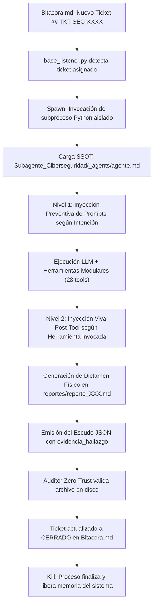
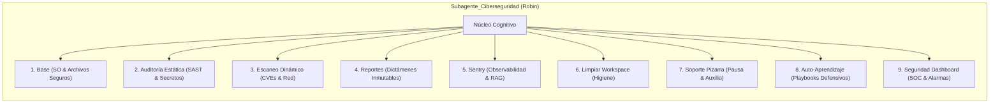

# Documentación del Sistema: Subagente de Ciberseguridad (Robin)

**Identificador Canónico de Sistema:** `Subagente_Ciberseguridad`  
**Identidad Conversacional / Alias de Tripulación:** `Robin`  
**Perfil Maestro (SSOT Único):** `Subagente_Ciberseguridad/_agents/agente.md`  
**Script Ejecutable Único:** `Subagente_Ciberseguridad/subagente_ciberseguridad_agent.py`  
**Motor de Verificación y Resiliencia:** `Agente_Orquestador/qa_gherkin.py` y `Agente_Orquestador/bucle_autocorreccion.py`  
**Directorio de Entregables Oficiales:** `Subagente_Ciberseguridad/reportes/` y `Subagente_Ciberseguridad/informes/`  
**Estado Operativo:** Modernizado, Modularizado en 9 Skills (33 tools especializadas + 5 base memoria = 38 tools), Doctrina Zero-Trust Validada, Conectado al SOC del Dashboard, Motor QA Gherkin y Filtro Anti-Bucle Integrado.  

---

## 1. Misión y Rol en la Flota

El **Subagente de Ciberseguridad** (alias **Robin**) es el oficial encargado del blindaje defensivo, la auditoría estática y dinámica de código, y la mitigación de vulnerabilidades en todo el ecosistema de la tripulación de agentes autónomos. Opera bajo la coordinación del **Agente Orquestador** (*Luffy*), respondiendo a las misiones de seguridad asignadas en la Pizarra (`Bitacora.md`).

Sus responsabilidades nucleares abarcan:
- **Auditoría Estática de Código (SAST & Detección de Secretos):** Análisis exhaustivo de archivos Python, JavaScript, TypeScript, JSON y variables de entorno (`.env`) en busca de credenciales expuestas, tokens JWT, passwords hardcodeados y malas prácticas de codificación.
- **Blindaje y Análisis de Flujos n8n:** Inspección de archivos de workflows (`.json`) para detectar nodos webhook desprotegidos, credenciales en texto plano y nodos Code potencialmente vulnerables a inyecciones.
- **Escaneo Dinámico de Dependencias (SCA & CVEs):** Ejecución automatizada de `pip-audit` y `npm audit` para identificar componentes obsoletos o con vulnerabilidades conocidas en la base de datos de CVEs.
- **Inspección Perimetral y de Red:** Verificación de puertos locales en escucha (`netstat`/`ss`), auditoría de autenticación básica obligatoria en túneles ngrok e instancias n8n expuestas.
- **Monitoreo y Centinela del Dashboard (SOC Defensivo):** Supervisión continua del registro de intrusiones bloqueadas, auditoría de postura de la consola web (Bcrypt, JWT, Whitelist de IPs), contención de IPs agresoras y gestión de alarmas acústicas y visuales.
- **Generación de Reportes Técnicos Inmutables:** Redacción de dictámenes ejecutivos y técnicos en `Subagente_Ciberseguridad/reportes/` con clasificación de severidad CVSS/criticidad y pasos reproducibles de remediación.
- **Diagnóstico y Resiliencia con Sentry:** Monitoreo de excepciones en tiempo real, registro de soluciones probadas en ChromaDB y notificación de fallos críticos.
- **Soporte en Pizarra y Pausa Operativa:** Capacidad de pausar su ejecución y solicitar ayuda o delegaciones ante bloqueos o necesidad de autorizaciones del usuario.
- **Auto-Aprendizaje Continuo:** Consulta obligatoria previa de blueprints defensivos probados antes de emitir recetas de mitigación, y registro metódico de nuevas soluciones exitosas.

---

## 2. Arquitectura de Ciclo de Vida (Spawn Efímero)

Al igual que el resto de los subagentes especializados de la tripulación, el **Subagente de Ciberseguridad** opera bajo un modelo de **ejecución efímera bajo demanda**:



Beneficios del diseño:
1. **Consumo Cero en Reposo:** No retiene memoria en el servidor cuando no hay auditorías en curso.
2. **Inmunidad a Alucinaciones Acumuladas:** Cada ciclo arranca con contexto prístino.
3. **Persistencia Determinista:** Todos los hallazgos y evidencias quedan grabados físicamente en disco.

---

## 3. Implementación de las 5 Reglas de Oro

El Subagente de Ciberseguridad implementa estrictamente las **5 Reglas de Oro Arquitectónicas** de la flota:

| Regla de Oro | Implementación en Subagente_Ciberseguridad | Beneficio Técnico |
| :--- | :--- | :--- |
| **1. Desacoplamiento Modular Absoluto** | Las 8 habilidades residen en subdirectorios independientes bajo `Subagente_Ciberseguridad/skills/<skill>/` con su propio `__init__.py`, script de lógica (`skill_<nombre>.py`) y espejo cognitivo (`Skill_<Nombre>_Subagente_Ciberseguridad.md`). | Módulos herméticos; auditar dependencias no impacta el módulo de reportes ni sentry. |
| **2. Decorador Canónico `@tool` con Tipado Fuerte** | Las 28 herramientas emplean `@tool` de LangChain con esquemas de tipos completos (`str`, `int`, `dict`, `bool`) y docstrings detallados. | Inferencia multi-proveedor perfecta (OpenAI, DeepSeek, Claude, Llama) e introspección nativa. |
| **3. Encapsulamiento del Prompt de Habilidad** | Cada habilidad cuenta con su función `obtener_prompt_<nombre_skill>()` que extrae el System Prompt desde su archivo `.md`. | Prohibición de prompts hardcodeados; actualización de directivas sin tocar el código Python. |
| **4. Documentación Canónica y Obsidian Sync** | Los 8 archivos `.md` de habilidades incluyen enlaces de grafo (`Perfil_Subagente_Ciberseguridad`, `Reglas de la Tripulacion`) y se sincronizan con `sync_cerebro.py`. | Grafo de conocimiento vivo y vectorización automática en ChromaDB. |
| **5. Manejo Resiliente de Errores y Blindaje** | Captura exhaustiva de excepciones (`try/except`), logs informativos y respuestas estructuradas ante comandos fallidos o herramientas externas no instaladas. | Tolerancia absoluta a fallos de red o herramientas faltantes en el entorno host. |

---

## 4. Inyección Dinámica de Prompts y Economía de Tokens

Para optimizar la ventana de contexto y controlar el consumo de tokens en tareas monográficas, se implementa una arquitectura en dos capas:

### 4.1. Nivel 1: Detección Preventiva Quirúrgica
Antes de llamar al LLM, la función `detectar_prompts_habilidad(instruccion)` examina la tarea asignada:
- Si la orden refiere a **secretos, sast o n8n**, inyecta únicamente el prompt de `auditoria`.
- Si involucra **cves, puertos, dependencias o ngrok**, inyecta `escaneo`.
- Si solicita un **informe formal o ticket**, inyecta `reportes`.
- Si involucra **excepciones o monitoreo**, inyecta `sentry`.
- Si requiere **higiene o limpieza**, inyecta `limpiar_workspace`.
- Si se detecta **bloqueo o solicitud de ayuda**, inyecta `solicitar_soporte_pizarra`.
- Si se busca **recetas o blueprints**, inyecta `auto_aprendizaje`.

### 4.2. Nivel 2: Inyección Viva Post-Tool (`MAPA_HERRAMIENTA_PROMPTS`)
Durante el ciclo iterativo del agente, cuando el LLM ejecuta cualquiera de las 28 herramientas, el despachador inyecta las directivas especializadas de la habilidad invocada directamente en la respuesta del tool call (`messages`), recordando al LLM las restricciones de formato, severidad y pasos a seguir.

---

## 5. Catálogo Maestro de Habilidades (9 Skills / 33 Tools Especializadas)



### Detalle de las 33 Herramientas Especializadas

1. **`skills/base/` (4 tools):**
   - `crear_archivo(ruta, contenido)`: Escritura atómica blindada por firewall de rutas.
   - `leer_archivo(ruta)`: Lectura de archivos locales permitidos.
   - `listar_directorio(ruta)`: Inspección de estructura de carpetas autorizadas.
   - `ejecutar_comando(comando)`: Ejecución en shell con lista negra de comandos peligrosos.
2. **`skills/auditoria/` (6 tools):**
   - `leer_archivo_seguro(ruta)`: Lectura de inspección con enmascaramiento preventivo.
   - `listar_directorio_auditoria(ruta)`: Listado con detección de archivos sensibles (`.env`, `.pem`, etc.).
   - `buscar_patron_en_directorio(ruta_directorio, patron_regex, extensiones)`: Rastreo regex multihilo de patrones de riesgo.
   - `detectar_secretos_expuestos(ruta)`: Escaneo con firmas conocidas de API Keys (OpenAI, AWS, GitHub, Stripe, DB URLs).
   - `leer_workflow_n8n(ruta_archivo)`: Parser estático de flujos n8n para análisis de webhooks y credenciales.
   - `verificar_gitignore(ruta_directorio)`: Auditoría de reglas de exclusión de secretos en repositorios Git.
3. **`skills/escaneo/` (6 tools):**
   - `ejecutar_pip_audit(requisitos_path)`: Auditoría de vulnerabilidades en paquetes Python.
   - `ejecutar_npm_audit(package_json_path)`: Auditoría de vulnerabilidades en paquetes Node.js/npm.
   - `verificar_puertos_locales(puertos_interes)`: Comprobación de sockets de red en escucha local.
   - `verificar_auth_ngrok()`: Verificación de flag `--basic-auth` en procesos y configs ngrok.
   - `verificar_auth_n8n()`: Verificación de variables de entorno de autenticación segura en n8n.
   - `analizar_permisos_archivo(ruta)`: Comprobación de permisos octales o ACLs sobre archivos críticos.
4. **`skills/reportes/` (3 tools):**
   - `generar_reporte_vulnerabilidades(titulo, hallazgos, recomendaciones, nivel_criticidad)`: Creación física de reporte Markdown en `reportes/reporte_XXX.md`.
   - `crear_ticket_seguridad(titulo_vulnerabilidad, severidad, descripcion, pasos_remediacion, asignado_a)`: Creación de ticket en `Bitacora.md`.
   - `leer_ultimo_reporte()`: Recuperación del informe de auditoría más reciente generado en disco.
5. **`skills/sentry/` (3 tools):**
   - `tool_consultar_sentry_errores(filtro, limite)`: Consulta de excepciones y RAG en ChromaDB.
   - `tool_registrar_solucion_error(error_id, solucion)`: Persistencia de solución en memoria vectorial.
   - `tool_reportar_fallo_critico(mensaje, detalles)`: Registro de alertas críticas de seguridad.
6. **`skills/limpiar_workspace/` (2 tools):**
   - `tool_limpiar_habitacion(simulacion)`: Higiene interna del directorio de Ciberseguridad.
   - `tool_limpiar_workspace(dias_antiguedad, patron)`: Purga selectiva en `Archivos_temporales/`.
7. **`skills/solicitar_soporte_pizarra/` (2 tools):**
   - `tool_solicitar_ayuda_pizarra(tarea_requerida, destinatario_tipo, subagente_sugerido, motivo_bloqueo, contexto_actual, evidencia_previa)`: Pausa operativa y ticket de auxilio en Pizarra (`Bitacora.md`).
   - `tool_consultar_estado_ticket_pizarra(ticket_id)`: Consulta del estado del ticket de soporte.
8. **`skills/auto_aprendizaje/` (2 tools):**
   - `tool_consultar_playbook_memoria(tema_o_dominio)`: [Paso 0 Obligatorio] Consulta de playbooks y blueprints defensivos en `memoria/` y ChromaDB.
   - `tool_registrar_playbook_memoria(titulo, categoria, dominio, paso_a_paso_skills, tokens_y_esquema, blueprint_reutilizable, variables_adaptables, evidencia_fisica)`: [Paso Final Obligatorio] Registro de nueva receta metodológica exitosa.
9. **`skills/seguridad_dashboard/` (5 tools):**
   - `tool_consultar_incidentes_dashboard(limite)`: Inspección forense del registro de intrusiones bloqueadas, IPs agresoras y rutas atacadas.
   - `tool_verificar_estado_alarma_dashboard()`: Comprobación en tiempo real del estado de la alarma acústica/visual del Dashboard.
   - `tool_gestionar_alarma_dashboard(accion, motivo)`: Silenciamiento documentado de alarmas (`"silenciar"`) o purga de historial (`"limpiar_historial"`).
   - `tool_auditar_postura_dashboard()`: Auditoría global de la consola (Bcrypt, JWT, `ALLOWED_IPS`, comandos remotos) con puntuación defensiva 0-100.
   - `tool_bloquear_ip_dashboard(ip, motivo)`: Contención perimetral y aislamiento inmediato de IPs atacantes.

---

## 6. Firewall Determinístico y Seguridad de Entregables

El módulo `skill_base.py` implementa el cortafuegos de acceso a disco:

- **Directorio Oficial de Reportes:** `/app/Subagente_Ciberseguridad/reportes/` (archivos `reporte_XXX.md`).
- **Directorio Oficial de Informes:** `/app/Subagente_Ciberseguridad/informes/`.
- **Directorio de Archivos Temporales:** `/app/Archivos_temporales/` (únicamente con prefijos `ciberseguridad_` o `robin_`).
- **Zonas Bloqueadas:** Modificación no autorizada de núcleos de otros agentes o scripts de infraestructura.
- **Lista Negra de Comandos:** Bloqueo explícito de comandos destructivos (`rm -rf`, `mkfs`, `dd`, `shutdown`).

---

## 7. Protocolo de Cierre: Escudo JSON y Verificación Zero-Trust

Al concluir una auditoría, el agente entrega obligatoriamente el formato JSON estricto:

```json
{
  "ticket_actualizado": "## TKT-SEC-2026XXXX\n- **Tarea:** Auditoría de Seguridad\n- **Responsable:** Subagente_Ciberseguridad\n- **Estado:** COMPLETADO\n- **Evidencia_Fisica:** /app/Subagente_Ciberseguridad/reportes/reporte_001.md\n- **Contexto:** Dictamen de seguridad...\n- **Historial:** Bitácora de hallazgos...",
  "evidencia_hallazgo": "/app/Subagente_Ciberseguridad/reportes/reporte_001.md"
}
```

El listener del orquestador realiza la comprobación física:
1. `os.path.exists(evidencia_hallazgo) == True`.
2. `os.path.getsize(evidencia_hallazgo) > 0`.
3. Verificación de firma y fecha reciente.
4. Solo tras validar físicamente el entregable se marca el ticket como `CERRADO` en `Bitacora.md`.

---

## 8. Resultados de Validación Operativa y Resiliencia en Vivo

El Subagente de Ciberseguridad fue sometido a una prueba integral en One-Shot bajo el ticket `## TKT-SEC-20261005001`, validando sus habilidades en tiempo real sobre el contenedor `tripulacion_ia_v3`:

1. **Ejecución de Habilidades Canónicas:**
   - **Auto-Aprendizaje (Paso 0):** Consultó con éxito la memoria procedural antes de programar o auditar.
   - **Higiene:** Purgó 9 cachés `__pycache__` huérfanas sin afectar código productivo.
   - **SAST & Secretos:** Inspeccionó el repositorio `/app` y verificó línea a línea que 3 supuestas alertas de secretos eran falsos positivos (`os.getenv`).
   - **Perímetro y Escaneo:** 0 puertos críticos expuestos; detectó permisos `0o777` en `/app/.env` y 14 CVEs en dependencias Python (`pip-audit`).
   - **Reporte Físico:** Emitió [`reporte_006.md`](file:///c:/Users/admin/Documents/Agentes/Subagente_Ciberseguridad/reportes/reporte_006.md) (5,372 bytes).
   - **Auto-Aprendizaje (Paso Final):** Registró el Playbook #45 en `memoria/` (`45_Subagente_Ciberseguridad_Playbook_auditor_a_de_seguridad_validaci_...md`, 4,139 bytes).
2. **Ciclo Autónomo de Remediación:**
   - Robin abrió el ticket `## TKT-SEC-20261005220459` para `Subagente_Desarrollo` con 4 hallazgos ALTO.
   - Desarrollo remedió:
     * **H-02 y H-03:** Inyectó autenticación de cabecera (`headerAuth`) y credenciales `httpHeaderAuth` en los flujos n8n.
     * **H-04:** Actualizó librerías en `requirements_seguridad_remediado.txt`, reduciendo CVEs de 14 a 5 (los 5 restantes en `chromadb 1.5.9` sin versión superior en PyPI; mitigado localmente).
     * **H-01:** Documentó la naturaleza de los bind mounts Windows/WSL2 (drvfs/9p donde `chmod` POSIX no puede alterar ACLs de Windows) y entregó `remediacion_H01_permisos_env.ps1`.
3. **Auditoría Zero-Trust del Orquestador:**
   - Luffy inspeccionó físicamente los 4 artefactos en disco, validó los webhooks con script Python, notificó a Telegram y cerró formalmente ambos tickets en `Bitacora.md`, registrando el Playbook #48.
4. **Conexión SOC con el Dashboard:**
   - Con la incorporación de la Habilidad 9 (`seguridad_dashboard`), Robin se enlaza a la telemetría de `incidentes_seguridad.json`, permitiendo auditar intrusiones, silenciar alarmas justificadamente y mantener la postura de la consola en 100/100.

---
**Conexiones:** [[sistema]]
