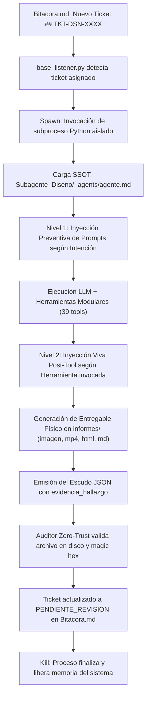

# Documentación del Sistema: Subagente de Diseño (Nami)

**Identificador Canónico de Sistema:** `Subagente_Diseno`  
**Identidad Conversacional / Alias de Tripulación:** `Nami`  
**Perfil Maestro (SSOT Único):** `Subagente_Diseno/_agents/agente.md`  
**Script Ejecutable Único:** `Subagente_Diseno/subagente_diseno_agent.py`  
**Motor de Verificación y Resiliencia:** `Agente_Orquestador/qa_gherkin.py` y `Agente_Orquestador/bucle_autocorreccion.py`  
**Directorio de Entregables Oficiales:** `Subagente_Diseno/informes/`  
**Manual de Identidad y Marca:** `Subagente_Diseno/brand_book.json`  
**Estado Operativo:** Modernizado, Modularizado en 12 Skills Canónicas (34 tools especializadas + 5 base memoria = 39 tools activas), Motor Local Pillow con Branding Editorial y WebP, Generación I2V con Higgsfield en 2 Pasos, Postproducción Dinámica de Vídeo (FFmpeg), Descarga Universal Multimedia (yt-dlp), Presentaciones Marp, Motor QA Gherkin y Filtro Anti-Bucle Integrado.

---

## 1. Misión y Rol en la Flota

El **Subagente de Diseño** (alias **Nami**) es la Directora Creativa, Diseñadora Gráfica, Navegante de Interfaces y Productora Multimedia de la tripulación autónoma. Opera bajo la coordinación del **Agente Orquestador** (*Luffy*), respondiendo a los requerimientos visuales, publicitarios, cinematográficos y de branding asignados en la Pizarra (`Bitacora.md`).

Sus responsabilidades nucleares abarcan:
- **Dirección de Arte y Generación Multimedia IA (`ia_creativa`):** Creación de imágenes publicitarias y packshots de alta conversión comercial mediante Higgsfield AI (modelos `marketing-studio/image`, `higgsfield/ai-influencer`, `higgsfield-ai/soul/v2/standard`, `ideogram/v4.0`, `recraft/v4.1`). Apoyada en 3 catálogos maestros (`catalogo_estilos.json`, `catalogo_prompts_publicitarios.json`, `catalogo_sujetos_humanos.json`) y el manual `brand_book.json` con la herramienta `consultar_brand_book`.
- **Motor Gráfico Local y Maquetación de Feeds (`imagenes_locales`):** Renderizado autónomo en local (Pillow) a costo $0 de carruseles de Instagram (1080x1350) con formato Dark Bento, numeración secuencial unificada y superposición de branding editorial respetando el 28% de espacio negativo protegido.
- **Vídeo Cinemático e Imagen en Movimiento (`video`):** Generación de vídeo mediante la **Doctrina en 2 Pasos** (Image-to-Video > Text-to-Video). Primero keyframe estático con `ia_creativa` y luego animación I2V con Higgsfield AI (`kling-video/v3.0-turbo`, `alibaba/wan-3.0-prime`, `bytedance/seedance-2.5`).
- **Edición Dinámica de Vídeo y Postproducción Viral (`edicion_video`):** Edición programática con FFmpeg y composiciones RGBA de Pillow para vídeos verticales 9:16 (1080x1920) integrando Pop-up Overlays flotantes, B-Roll Picture-in-Picture, subtítulos cinéticos estilo Alex Hormozi (`#FFE600`) y Lower Thirds Dark Bento.
- **Descarga Universal de Multimedia y Redes Sociales (`descargar_multimedia`):** Descarga de vídeos MP4 en máxima resolución y extracción directa de pistas de audio MP3 desde Instagram, TikTok, YouTube, Facebook y X mediante `yt-dlp` local a costo $0.
- **Presentaciones Ejecutivas con Marp (`presentaciones`):** Compilación dual de diapositivas 16:9: archivo Markdown estructurado para Marp Core y visor interactivo HTML autocontenido con navegación por teclado y modo pantalla completa.
- **Búsqueda Web de Referencias y Benchmarking (`buscar_internet`):** Rastrear tendencias visuales, códigos HEX de paletas cromáticas, combinaciones tipográficas y análisis de competidores.
- **Diagnóstico y Resiliencia con Sentry (`sentry`):** Consulta previa de antecedentes de error en RAG y registro inmutable de soluciones aprendidas en `Memoria_Viva_Errores.md`.
- **Sanitización y Orden de Workspace (`limpiar_workspace`):** Preservar la higiene de las 3 carpetas canónicas (`_agents`, `informes`, `skills`) y purgar cachés residuales sin pérdida de datos.
- **Soporte en Pizarra y Pausa Operativa (`solicitar_soporte_pizarra` [HS-08]):** Pausa operativa inmediata ante dependencias técnicas de `Subagente_Desarrollo`, `Subagente_Ciberseguridad` o `Subagente_Asistencia`.
- **Auto-Aprendizaje Continuo y Memoria Procedural (`auto_aprendizaje` [HS-07]):** Paso 0 obligatorio de consulta semántica de playbooks en `memoria/` para entrega en One-Shot, y Paso Final obligatorio de registro de nuevas recetas visuales.

---

## 2. Arquitectura de Ciclo de Vida (Spawn Efímero)

El **Subagente de Diseño** opera bajo un modelo de **ejecución efímera bajo demanda**:



---

## 3. Implementación de las 5 Reglas de Oro

| Regla de Oro | Implementación en Subagente_Diseno | Beneficio Técnico |
| :--- | :--- | :--- |
| **1. Desacoplamiento Modular Absoluto** | 12 paquetes independientes bajo `Subagente_Diseno/skills/<skill>/` con su propio `__init__.py`, script de lógica (`skill_<nombre>.py`) y espejo cognitivo (`Skill_<Nombre>_Subagente_Diseno.md`). Separación estricta entre generación de vídeo (`video`) y postproducción (`edicion_video`). | Módulos herméticos; modificar filtros de vídeo o FFmpeg no impacta en generación de imágenes ni en presentaciones. |
| **2. Decorador Canónico `@tool` con Tipado Fuerte** | Las 34 herramientas especializadas emplean `@tool` de LangChain con esquemas Pydantic (`BaseModel`, `Field`) y docstrings tipados. | Inferencia multi-proveedor perfecta e introspección de esquemas (OpenAI Tool Calling) con validación estricta de parámetros. |
| **3. Encapsulamiento del Prompt en la Cabecera de la Habilidad** | Cada habilidad cuenta con su función `obtener_prompt_<skill>()` sincronizada directamente con la cabecera del archivo `.md` respectivo (las 12 skills cumplen el estándar de 5 secciones). | El System Prompt reside en la cabecera y se inyecta dinámicamente sin duplicaciones estáticas ni resúmenes triviales. |
| **4. Documentación Canónica y Obsidian Sync** | Los 12 archivos `.md` de habilidades incluyen enlaces de grafo (`Perfil_Subagente_Diseno`, `Reglas de la Tripulacion`, `Bitacora`). | Grafo de conocimiento vivo y sincronización con `sync_cerebro.py` y ChromaDB. |
| **5. Manejo Resiliente de Errores y Blindaje** | Captura exhaustiva de excepciones (`try/except`), conmutación a costo $0 (Pollinations FLUX.1 o Pillow local si Higgsfield requiere saldo), y respuestas estructuradas en JSON. | Resiliencia operacional total; cero bloqueos por falta de saldo y transparencia total sin mocks. |

---

## 4. Inyección Dinámica de Prompts en Dos Niveles

### Nivel 1: Inyección Preventiva por Intención (Pre-LLM)
Antes de llamar al modelo, la función `detectar_prompts_habilidad(texto_tarea)` analiza las palabras clave del ticket:
* Si la tarea menciona imágenes, packshots o marcas, inyecta `obtener_prompt_ia_creativa()`.
* Si menciona vídeos, clips o reels con IA, inyecta `obtener_prompt_video()`.
* Si menciona subtítulos Hormozi, B-roll o stickers, inyecta `obtener_prompt_edicion_video()`.
* Si menciona descargar enlaces o audios de redes, inyecta `obtener_prompt_descargar_multimedia()`.
* Si menciona presentaciones o pitch decks, inyecta `obtener_prompt_presentaciones()`.
* Si menciona carruseles o feeds, inyecta `obtener_prompt_imagenes_locales()`.

### Nivel 2: Inyección Viva Post-Tool (Inter-rondas)
Al ejecutarse una herramienta, el mapa `MAPA_HERRAMIENTA_PROMPTS` intercepta el resultado e inserta las directivas vivas de la habilidad en el historial del LLM (`ToolMessage`) para guiar la siguiente ronda de pensamiento.

---

## 5. Catálogo Canónico de las 12 Habilidades (39 Tools Activas)

| # | Habilidad | Módulo | Herramientas Principales | Salidas Oficiales |
| :--- | :--- | :--- | :--- | :--- |
| **1** | **Base del Sistema** | `skills/base/` | `crear_archivo`, `leer_archivo`, `listar_directorio`, `ejecutar_comando` | Archivos de código y prototipos HTML |
| **2** | **IA Creativa** | `skills/ia_creativa/` | `generar_multimedia_ia`, `auditar_calidad_imagen`, `consultar_catalogo_prompts`, `consultar_catalogo_estilos`, `consultar_catalogo_sujetos`, `consultar_brand_book` | PNG/JPG + `.verificacion.json` |
| **3** | **Imágenes Locales** | `skills/imagenes_locales/` | `maquetar_carrusel_instagram`, `maquetar_carrusel_completo`, `superponer_branding_producto` | Carruseles 4:5 PNG/WebP con branding |
| **4** | **Vídeo Cinemático (I2V)** | `skills/video/` | `generar_video_ia`, `estructurar_prompt_movimiento_video` | Archivos MP4 I2V (Higgsfield) |
| **5** | **Edición Dinámica de Vídeo** | `skills/edicion_video/` | `superponer_motion_overlay`, `insertar_broll`, `generar_subtitulos_dinamicos`, `generar_lower_third_callout`, `ensamblar_edicion_video_completa` | Vídeos verticales 9:16 con captions ASS |
| **6** | **Descargar Multimedia** | `skills/descargar_multimedia/` | `descargar_video_redes`, `extraer_audio_redes`, `inspeccionar_info_multimedia` | Vídeos MP4 y audios MP3 (yt-dlp) |
| **7** | **Presentaciones** | `skills/presentaciones/` | `generar_presentacion_marp` | Slides Marp `.md` y Visor HTML interactivo |
| **8** | **Buscar Internet** | `skills/buscar_internet/` | `buscar_referencias_diseno` | Enlaces, paletas HEX y resúmenes de diseño |
| **9** | **Sentry & Errores** | `skills/sentry/` | `tool_consultar_sentry_errores`, `tool_registrar_solucion_error`, `tool_reportar_fallo_critico` | `Memoria_Viva_Errores.md` |
| **10** | **Limpiar Workspace** | `skills/limpiar_workspace/` | `tool_limpiar_workspace_diseno`, `tool_limpiar_workspace` | Sanitización y purga de cachés |
| **11** | **Soporte Pizarra** | `skills/solicitar_soporte_pizarra/` | `tool_solicitar_ayuda_pizarra`, `tool_consultar_estado_ticket_pizarra` | Tickets de auxilio en `Bitacora.md` |
| **12** | **Auto-Aprendizaje** | `skills/auto_aprendizaje/` | `tool_consultar_playbook_memoria`, `tool_registrar_playbook_memoria` | Playbooks en `memoria/` |

---

## 6. Manual de Identidad de Marca (`brand_book.json`)

El manual de marca reside en `Subagente_Diseno/brand_book.json` y es consultado en tiempo de ejecución:
* **Ecosistema Tripulación IA (`tripulacion_ia`):** Paleta Dark Tech (`#020617`, `#0F172A`, `#6366F1`, `#38BDF8`), tipografía Plus Jakarta Sans / Outfit, iluminación Studio Dark Mode con destellos índigo, espacio negativo del 40% superior.
* **Café de Especialidad Demo (`cafe_artesanal`):** Paleta Gourmet Ámbar (`#1C1917`, `#D97706`, `#F59E0B`), tipografía Playfair Display / Inter, iluminación Golden Hour y 45% de espacio negativo superior derecho para copys de marketing.
* **Herramienta de Consulta:** `consultar_brand_book(marca="...")` entrega los parámetros oficiales al modelo para garantizar consistencia en todas las piezas generadas.

---

## 7. Formato Obligatorio de Cierre de Ticket (JSON Estricto)

Al finalizar la misión, la respuesta del agente se valida como un JSON único:
```json
{
  "ticket_actualizado": "## TKT-DSN-[ID]\n- **Tarea:** ...\n- **Contexto:** ...\n- **Historial:**\n  - [Subagente_Diseno - 2026-10-07]: Entregables generados y auditados en disco.\n- **Evidencia_Fisica:** /app/Subagente_Diseno/informes/<archivo_generado>\n- **Estado:** PENDIENTE_REVISION\n- **Responsable:** Agente_Orquestador",
  "Evidencia_Fisica": "/app/Subagente_Diseno/informes/<archivo_generado>",
  "evidencia_hallazgo": "Se generaron y verificaron exitosamente los assets visuales en /app/Subagente_Diseno/informes/ con metadatos de verificación física en disco."
}
```

---

## 8. Motor de Verificación y Filtro Anti-Bucle en Tiempo de Ejecución

Durante la ejecución del ciclo de diseño (`subagente_diseno_agent.py`), las llamadas a herramientas pasan por `interceptar_tool_call`:
- **Filtro Anti-Bucle:** Evita llamadas redundantes idénticas a herramientas de IA creativa o APIs multimedia cuando los assets ya fueron generados.
- **Validación QA Gherkin:** Comprueba en tiempo real que las imágenes, scripts de postproducción o presentaciones generen archivos válidos en disco y no stubs vacíos.
- **Diagnóstico y Recuperación:** Detecta fallos de dependencias multimedia (Pillow, FFmpeg, yt-dlp) y provee diagnósticos de causa raíz.
- **Referencias:** Script_Bucle_Autocorreccion y Script_Qa_Gherkin.

---
*Documento maestro de arquitectura del Subagente de Diseño.*

---
**Conexiones:** [[sistema]]
