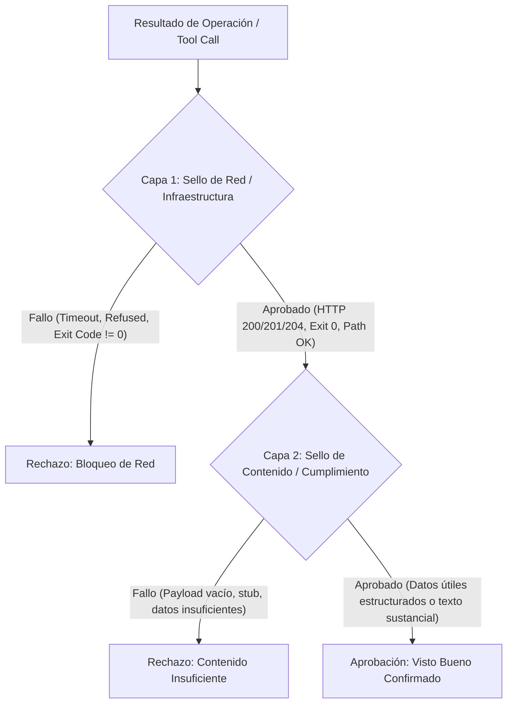

# Documentación Técnica: `qa_gherkin.py`

**Ubicación del Script:** `Agente_Orquestador/qa_gherkin.py`  
**Rol del Módulo:** Validador Universal de Calidad, Cumplimiento de Contenido y Criterios Gherkin  
**Subsistema:** Motor de Calidad y Verificación Funcional de la Flota  

---

## 1. Propósito General

`qa_gherkin.py` es el motor de control de calidad universal para las operaciones ejecutadas por los agentes de la tripulación. Su objetivo es asegurar que ninguna tarea se dé por completada simplemente porque una llamada a una herramienta o servicio retornó un código HTTP 200 o finalizó sin excepción en la red.

### Directiva Universal:
> *"Tu rol como QA Gherkin no es aprobar la velocidad ni el código de respuesta de la red. Tu única misión es verificar que el resultado entregado por el agente responda directamente a la intención del usuario. Si la tarea requería contar, listar o extraer información, el agente tiene prohibido cerrar el ticket hasta que los datos hayan sido procesados y volcados en el reporte final."*

---

## 2. Principio de Doble Validación

El módulo implementa un modelo de evaluación en dos fases secuenciales:



### 2.1. Capa 1: Sello de Red e Infraestructura (`validar_capa_red`)
Verifica la integridad de la ejecución en el nivel de transporte o sistema operativo:
- **Códigos HTTP de Éxito:** Valida códigos `200`, `201`, `204`. Códigos de error (`4xx`, `5xx`) disparan fallo inmediato.
- **Detección de Códigos de Retorno del Sistema:** Para herramientas como `ejecutar_comando` y `python_ejecutar_script`, inspecciona `codigo_retorno`/`exit_code`. Cualquier valor distinto de `0` se cataloga como fallo con extracción de los primeros 300 caracteres de `stderr`.
- **Detección de Bloqueos de Conectividad:** Rastrea patrones de infraestructura como `connection refused`, `timeout`, `cloudflare block`, `ECONNREFUSED` y `socket hang up`.
- **Patrones de Éxito Multiplataforma:** Reconoce rutas tanto de Linux/Docker (`/app/`) como de Windows (`[a-zA-Z]:[\/]`).

### 2.2. Capa 2: Sello Funcional y Cumplimiento (`validar_capa_contenido`)
Comprueba que el payload devuelto posea información sustancial respecto al objetivo del ticket:
- **Operaciones de Escritura (`POST`, `PUT`, `DELETE`, `PATCH`):** El éxito a nivel de infraestructura constituye evidencia suficiente de mutación de estado.
- **Operaciones de Lectura (`GET` o consultas de datos):** El éxito de red es únicamente el primer paso. Se exige que el resultado contenga datos analizables:
  - Inspección de campos clave: `data`, `datos`, `workflows`, `resultado`, `items`, `nodes`, `connections`, `results`, `flujos`, `respuesta`.
  - Comprobación de colecciones no vacías (`len > 0`).
  - Verificación de longitud textual sustancial (> 300 caracteres para respuestas complejas; longitud mínima > 80 caracteres).
- **Prevención de Cierres Prematuros:** Si una consulta devuelve datos vacíos o un mensaje genérico, QA Gherkin bloquea el cierre del flujo y exige al agente analizar la situación.

---

## 3. Función Principal: `evaluar_qa_gherkin`

Es el punto de entrada canónico utilizado por el interceptor de autocorrección:

```python
from qa_gherkin import evaluar_qa_gherkin

aprobado = evaluar_qa_gherkin(
    resultado_operacion=resultado,
    objetivo_ticket="Crear microservicio y verificar endpoints",
    nombre_agente="Subagente_Desarrollo"
)
```

- **Parámetros:**
  - `resultado_operacion`: Dict, JSON string o texto devuelto por la herramienta.
  - `objetivo_ticket`: Descripción textual del requerimiento o criterio de aceptación del ticket.
  - `nombre_agente`: Nombre del agente para trazabilidad en logs.
- **Retorno:** `bool` (`True` si ambas capas son aprobadas; `False` si alguna falla).

---

## 4. Robustez de Entorno y Trazabilidad

- **Manejo Seguro de UTF-8:** Configura `sys.stdout` y `sys.stderr` con `reconfigure(encoding="utf-8", errors="replace")` para prevenir caídas por caracteres no imprimibles en consolas de Windows o PowerShell.
- **Trazabilidad Gherkin en Consola:** Formatea la evaluación visualmente bajo el estándar Gherkin:
  - `[Dado]`: Estado o salida devuelta por la herramienta.
  - `[Capa Red]`: Veredicto del estado de infraestructura.
  - `[Capa Cont.]`: Veredicto del cumplimiento del contenido.
  - `[Cuando]`: Contraste contra el objetivo del ticket.
  - `[Entonces]`: Visto bueno final autorizando o bloqueando el hard-stop.

---
**Conexiones:** [[sistema]]
