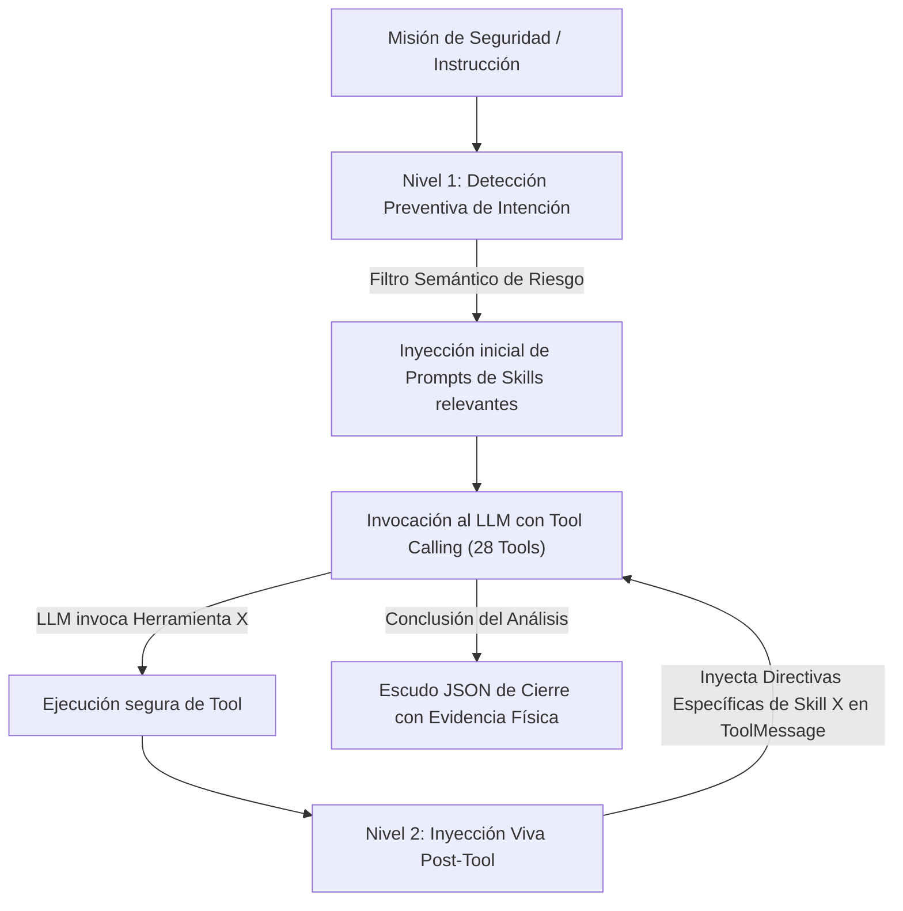

# Documentación Técnica: `subagente_ciberseguridad_agent.py`

**Ubicación del Script Único:** `Subagente_Ciberseguridad/subagente_ciberseguridad_agent.py`  
**Perfil Maestro (SSOT Único):** `Subagente_Ciberseguridad/_agents/agente.md`  
**Rol del Módulo:** Motor de Inferencia Cognitiva, Auditoría SAST/SCA y Blindaje Zero-Trust  
**Subsistema:** Subagente de Ciberseguridad y Mitigación Preventiva  
**Identidad Canónica:** `Subagente_Ciberseguridad`  
**Identidad Conversacional / Alias:** `Robin`  

---

## 1. Propósito General

`subagente_ciberseguridad_agent.py` constituye el núcleo ejecutable del Subagente de Ciberseguridad. Es el motor responsable de procesar misiones de seguridad asignadas por el Agente Orquestador a través de la Pizarra (`Bitacora.md`), ejecutar análisis estático de código (SAST), detección de secretos y credenciales expuestas, auditoría de flujos n8n, escaneo de dependencias Python/Node.js, verificación perimetral de puertos y túneles ngrok, emisión de reportes técnicos inmutables y gestión de soporte en pizarra.

El módulo implementa un ciclo de vida efímero (**Spawn -> Exec -> Kill**) y un sistema de inyección dinámica en dos niveles (detección preventiva Nivel 1 y reactiva post-tool Nivel 2), garantizando un consumo mínimo de tokens y el cumplimiento irrestricto de las reglas [HS-01] a [HS-08].

---

## 2. Componentes y Arquitectura Interna

### 2.1. Carga de Identidad Canónica (SSOT)
- **Perfil Maestro:** Carga dinámicamente el archivo único de identidad `Subagente_Ciberseguridad/_agents/agente.md`.
- **Desacoplamiento Absoluto:** El nombre canónico `Subagente_Ciberseguridad` y el alias conversacional `Robin` se gestionan mediante constantes unificadas sin dispersión en código duro.
- **Hard-Stops Inviolables:** Integración nativa de las reglas [HS-01] (Cero Pérdida de Datos), [HS-02] (Zero-Trust físico), [HS-07] (Auto-Aprendizaje procedural) y [HS-08] (Solicitud de Soporte en Pizarra).

### 2.2. Inyección Dinámica de Prompts en Dos Niveles



1. **Nivel 1 (Pre-ejecución — Filtro Quirúrgico):** Analiza la orden entrante antes de la primera llamada al LLM e inyecta únicamente los system prompts de las habilidades afines (ej. si se pide auditar dependencias, se inyecta `escaneo`, suprimiendo la carga de `sentry`, `limpiar_workspace` o `reportes`).
2. **Nivel 2 (Inter-rondas en Vivo — `MAPA_HERRAMIENTA_PROMPTS`):** Al ejecutarse una herramienta, el runtime intercepta el resultado e inserta el System Prompt de la habilidad correspondiente en el hilo de mensajes para guiar el siguiente paso analítico.

### 2.3. Catálogo de Habilidades Modulares (9 Skills / 33 Tools Especializadas + 5 Memoria = 38 Tools)

Organizado en paquetes autónomos bajo `Subagente_Ciberseguridad/skills/<skill>/`:
1. **`base`:** Operaciones de archivos con cortafuegos de rutas (`crear_archivo`, `leer_archivo`, `listar_directorio`, `ejecutar_comando`).
2. **`auditoria`:** Auditoría SAST, detección de secretos, inspección de `.gitignore` y workflows n8n (`leer_archivo_seguro`, `listar_directorio_auditoria`, `buscar_patron_en_directorio`, `detectar_secretos_expuestos`, `leer_workflow_n8n`, `verificar_gitignore`).
3. **`escaneo`:** Escaneo de CVEs, puertos en red y autenticación ngrok/n8n (`ejecutar_pip_audit`, `ejecutar_npm_audit`, `verificar_puertos_locales`, `verificar_auth_ngrok`, `verificar_auth_n8n`, `analizar_permisos_archivo`).
4. **`reportes`:** Emisión de dictámenes y tickets en Pizarra (`generar_reporte_vulnerabilidades`, `crear_ticket_seguridad`, `leer_ultimo_reporte`).
5. **`sentry`:** Observabilidad de errores y RAG en ChromaDB (`tool_consultar_sentry_errores`, `tool_registrar_solucion_error`, `tool_reportar_fallo_critico`).
6. **`limpiar_workspace`:** Mantenimiento higiénico de carpetas de trabajo (`tool_limpiar_habitacion`, `tool_limpiar_workspace`).
7. **`solicitar_soporte_pizarra`:** Pausa operativa y ticket de auxilio al orquestador (`tool_solicitar_ayuda_pizarra`, `tool_consultar_estado_ticket_pizarra`).
8. **`auto_aprendizaje`:** Memoria procedural de playbooks defensivos (`tool_consultar_playbook_memoria`, `tool_registrar_playbook_memoria`).
9. **`seguridad_dashboard`:** Centinela del SOC, auditoría de postura y gestión de alarmas de consola (`tool_consultar_incidentes_dashboard`, `tool_verificar_estado_alarma_dashboard`, `tool_gestionar_alarma_dashboard`, `tool_auditar_postura_dashboard`, `tool_bloquear_ip_dashboard`).

### 2.4. Firewall Determinístico
- **Entregables Oficiales:** Restringidos a `Subagente_Ciberseguridad/reportes/` e `informes/`.
- **Archivos Temporales:** Canalizados hacia `Archivos_temporales/` con prefijos autorizados (`ciberseguridad_` o `robin_`).
- **Lista Negra de Comandos:** Bloqueo preventivo de operaciones destructivas en el sistema operativo.

### 2.5. Escudo JSON Zero-Trust
El agente garantiza una salida estructurada:
```json
{
  "ticket_actualizado": "## TKT-SEC-XXXX\n- **Tarea:** ...\n- **Responsable:** Subagente_Ciberseguridad\n- **Estado:** COMPLETADO\n- **Evidencia_Fisica:** /app/Subagente_Ciberseguridad/reportes/reporte_001.md\n- **Contexto:** ...\n- **Historial:** ...",
  "evidencia_hallazgo": "/app/Subagente_Ciberseguridad/reportes/reporte_001.md"
}
```
El listener verifica `os.path.exists` y el peso del archivo antes de marcar `CERRADO`.

---

## 3. Modos de Ejecución

1. **Modo Subproceso Aislado (Spawn Efímero):**
   - Disparado por `base_listener.py` al detectar un ticket asignado en `Bitacora.md`.
2. **Modo LangGraph Node (`funcion_nodo_subagente_ciberseguridad` / `funcion_nodo_robin`):**
   - Recibe el estado del grafo, procesa la tarea y retorna `{"messages": [AIMessage(content=respuesta_final)]}`.
3. **Modo CLI / Manual (`subagente_ciberseguridad_agent.py`):**
   - Ejecución directa interactiva desde terminal para pruebas y diagnósticos puntuales:
     ```bash
     python Subagente_Ciberseguridad/subagente_ciberseguridad_agent.py "Audita posibles secretos expuestos en .env"
     ```

---

## 4. Entradas y Salidas

- **Entradas:**
  - Instrucción textual asignada desde `Bitacora.md` o terminal.
  - Mensajes de contexto del canal de comunicación del agente.
- **Salidas:**
  - Reporte Markdown físico e inmutable en `Subagente_Ciberseguridad/reportes/reporte_XXX.md`.
  - JSON estructurado con el estado del ticket y la ruta física comprobada en `evidencia_hallazgo`.

---
**Conexiones:** [[sistema]]
