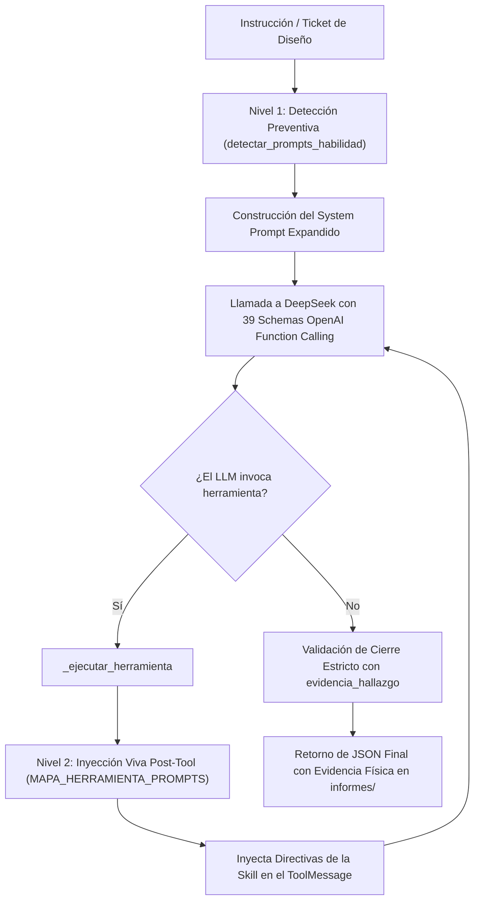

# Documentación Técnica: `subagente_diseno_agent.py`

**Ubicación del Script Único:** `Subagente_Diseno/subagente_diseno_agent.py`  
**Perfil Maestro (SSOT Único):** `Subagente_Diseno/_agents/agente.md`  
**Rol del Módulo:** Motor de Inferencia Cognitiva, Dirección Creativa, Síntesis Multimedia, Edición de Vídeo y Postproducción  
**Subsistema:** Subagente de Diseño y Producción Audiovisual  
**Identidad Canónica:** `Subagente_Diseno`  
**Identidad Conversacional / Alias:** `Nami`  
**Total Herramientas Activas:** 39 (34 modulares especializadas + 5 base de memoria y pizarra)  

---

## 1. Propósito General

`subagente_diseno_agent.py` es el script ejecutable y núcleo cognitivo del **Subagente de Diseño** (`Subagente_Diseno`, alias **Nami**). Es el responsable de procesar requerimientos creativos asignados por el Agente Orquestador en la Pizarra (`Bitacora.md`), generar imágenes comerciales y packshots publicitarios de producto mediante Higgsfield AI (o fallbacks a costo $0 con Pollinations FLUX.1 o Pillow local), maquetar carruseles educativos para feeds de Instagram, dirigir y animar clips de vídeo cinemático con la tecnología Image-to-Video (I2V), postproducir vídeos verticales (9:16) con subtítulos cinéticos estilo Hormozi y material B-Roll en PiP con FFmpeg, descargar o extraer pistas de audio desde redes sociales con `yt-dlp`, compilar presentaciones ejecutivas Marp con visor HTML interactivo y registrar recetas de diseño en la memoria procedural de la flota.

---

## 2. Arquitectura Interna del Módulo

### 2.1. Carga de Identidad Dual y Configuración LLM
- **Identidad Canónica:** `NOMBRE_AGENTE = "Subagente_Diseno"`.
- **Identidad Conversacional:** `NOMBRE_AGENTE_ALIAS = "Nami"`.
- **Inferencia LLM:** Opera por defecto sobre DeepSeek (`deepseek-chat`) vía OpenAI SDK compatible con `temperature=0.2` y control de costos mediante `costos_tracker.py`.
- **Perfil Canónico:** Carga el System Prompt base directamente desde `Subagente_Diseno/_agents/agente.md`.

---

### 2.2. Sistema de Inyección Dinámica de Prompts en Dos Niveles

1. **Nivel 1 (Pre-Inferencia):** `detectar_prompts_habilidad(texto_tarea)` escanea palabras clave (imágenes, carruseles, reels, tiktok, hormozi, broll, descarga, marp, sentry, playbooks, brand book) e inyecta preventivamente el System Prompt de las habilidades involucradas.
2. **Nivel 2 (Inter-Rondas Post-Tool):** `_procesar_tool_calls` intercepta cada tool call ejecutado y, utilizando `MAPA_HERRAMIENTA_PROMPTS`, agrega las directivas operativas vivas de esa habilidad al `ToolMessage` para guiar al modelo en la siguiente iteración.

---

### 2.3. Catálogo de Herramientas Cargadas (39 Tools)

Las 39 herramientas se importan de los 12 paquetes modulares bajo `Subagente_Diseno/skills/`:

1. **Memoria y Pizarra (5 tools):** `registrar_bitacora`, `guardar_cerebro`, `publicar_mensaje`, `leer_mensajes`, `leer_nodo_obsidian`.
2. **`base` (4 tools):** `crear_archivo`, `leer_archivo`, `listar_directorio`, `ejecutar_comando`.
3. **`ia_creativa` (6 tools):** `generar_multimedia_ia`, `auditar_calidad_imagen`, `consultar_catalogo_prompts`, `consultar_catalogo_estilos`, `consultar_catalogo_sujetos`, `consultar_brand_book`.
4. **`imagenes_locales` (3 tools):** `maquetar_carrusel_instagram`, `maquetar_carrusel_completo`, `superponer_branding_producto`.
5. **`video` (2 tools):** `generar_video_ia`, `estructurar_prompt_movimiento_video`.
6. **`edicion_video` (5 tools):** `superponer_motion_overlay`, `insertar_broll`, `generar_subtitulos_dinamicos`, `generar_lower_third_callout`, `ensamblar_edicion_video_completa`.
7. **`descargar_multimedia` (3 tools):** `descargar_video_redes`, `extraer_audio_redes`, `inspeccionar_info_multimedia`.
8. **`presentaciones` (1 tool):** `generar_presentacion_marp`.
9. **`buscar_internet` (1 tool):** `buscar_referencias_diseno`.
10. **`sentry` (3 tools):** `tool_consultar_sentry_errores`, `tool_registrar_solucion_error`, `tool_reportar_fallo_critico`.
11. **`limpiar_workspace` (2 tools):** `tool_limpiar_workspace_diseno`, `tool_limpiar_workspace`.
12. **`solicitar_soporte_pizarra` (2 tools):** `tool_solicitar_ayuda_pizarra`, `tool_consultar_estado_ticket_pizarra`.
13. **`auto_aprendizaje` (2 tools):** `tool_consultar_playbook_memoria`, `tool_registrar_playbook_memoria`.

---

### 2.4. Ciclo de Ejecución y Escudo JSON

- **Función Principal:** `ejecutar_ciclo(mensaje_entrada: str, historial: list = None) -> str`.
- **Rondas Máximas:** 50 iteraciones para permitir tareas complejas de múltiples capas de postproducción o carruseles multilámina.
- **Validación Estricta:** Exige un JSON válido con el campo obligatorio `evidencia_hallazgo` y `ticket_actualizado`. Si el modelo responde en texto libre, el runtime le exige corregir el formato.
- **Función de Nodo LangGraph:** `funcion_nodo_subagente_diseno(estado: dict)` y alias exportado `funcion_nodo_nami` para integración en flujos orquestados.

---

### 2.5. Rutas Físicas y Firewall

- `/app/Subagente_Diseno/informes/`: Destino exclusivo de entregables (imágenes, MP4, HTML, diapositivas).
- `/app/Archivos_temporales/`: Directorio central para pruebas efímeras (prefijo obligatorio `diseno_`).
- `/app/Bitacora.md`: Pizarra central para actualizar estado de tickets.
- `/app/Subagente_Diseno/brand_book.json`: Manual de identidad de marca.

---
*Documentación técnica de arquitectura de código para `subagente_diseno_agent.py`.*

---
**Conexiones:** [[sistema]]
